<a href="https://ademmila.dev">
  <picture>
    <source media="(prefers-color-scheme: dark)" srcset="https://raw.githubusercontent.com/linuxcoding-ADAM/linuxcoding-ADAM/main/assets/hero-dark.svg">
    <source media="(prefers-color-scheme: light)" srcset="https://raw.githubusercontent.com/linuxcoding-ADAM/linuxcoding-ADAM/main/assets/hero-light.svg">
    
  </picture>
</a>

  
  
  

I build **web platforms, Linux tools and interactive educational software**: a Rust terminal app with a sandboxed systemd daemon, a parametric CAD tool that runs in the browser, and multilingual platforms for young Algerians, some of them with public institutions.

I'm an undergraduate in my **second year (L2) of Science & Technology** at the University of Béjaïa, with a Baccalaureate in Technical Mathematics (Electrical Engineering). Linux has been my daily driver for four years.

---

## 🏛️ Institutional Collaborations

<table>
<tr>
<td valign="top" width="50%">

### WLADZ — Wlad Dzayer
**Educational Platform**

An educational and awareness platform designed for Algerian children, combining interactive games covering drug prevention, civics, history, and values.

I presented WLADZ to Algeria's **Minister of Youth**, who expressed interest in adopting the platform. Discussions included potential collaboration with the **Ministry of Youth**, including providing designers, to develop it toward a national-level platform.

**My contribution:** *Salati*, a 3D prayer-training game built with Three.js and GSAP, featuring Learn and Challenge modes, three difficulty levels, and an integrated scoring system.

`Three.js` · `GSAP` · `JavaScript`

👥 Co-developed by a team · Prototype stage · Source private

</td>
<td valign="top" width="50%">

### ODEJ Kiosk — Béjaïa
**In collaboration with ODEJ Béjaïa** · [**▶ live site**](https://odej-bejaia.netlify.app)

A touch-screen kiosk presenting Béjaïa province's 67 youth establishments on an interactive 3D map, in Arabic and English, in portrait and landscape. Built for the national youth-establishments fair in Algiers (11 November 2026).

**My contribution:** the establishment data and media pipeline. I structured the data for every establishment with a recorded source for each field, placed GPS pins from ODEJ's coordinate table, and encoded and published media to the CDN. I also built the establishment sheet and contact views.

`React 19` · `TypeScript` · `Vite` · `MapLibre` · `Netlify` · `Cloudflare Pages`

👥 Co-developed with <b>Slimane Sahnoune</b> · Source private

</td>
</tr>
</table>

---

## 🧩 Featured Engineering

### 🕌 [Salat](https://github.com/linuxcoding-ADAM/Salat) · prayer times and Adhan for the Linux terminal

A keyboard-first Rust TUI in the spirit of `btop` and `lazygit`, plus a headless `salat daemon` that runs as a sandboxed **systemd** user unit. [Landing page ↗](https://salat-website.vercel.app)

- **Scheduling that doesn't lie:** a dedicated scheduler owns wall-clock instants on a one-second tick, **decoupled from rendering**. A fired-event ledger and a catch-up pass mean no prayer is dropped or announced twice across redraws, restarts or suspend.
- **Deterministic under test:** time is injected behind one `Clock` abstraction, so DST, day rollover and catch-up are testable. Integration tests replay recorded API fixtures, including malformed responses, and make **no network calls**.
- **Offline by design:** city search uses a GeoNames index **compiled into the binary**. Config is human-editable TOML, written atomically, and unknown keys are rejected *with the line number*.
- **Hardened service:** `NoNewPrivileges`, a read-only filesystem outside its own directories, and `MemoryMax=128M`. It honours `NO_COLOR` and uses meaningful exit codes, so `salat status` works in a status bar.

`Rust 2024` · `Ratatui` · `Tokio` · `sqlx` + `SQLite` · `clap` · `reqwest`/`rustls` · `systemd`

<table>
<tr>
<td valign="top" width="50%">

### 🌍 [Forsati](https://github.com/linuxcoding-ADAM/forsati) · فرصتي
[**▶ live demo**](https://forsatii.vercel.app)

One mobile-first hub for the ODEJ youth establishments across Béjaïa, so young people can find their opportunities in one place.

- **Four languages, including Kabyle** (`ar` · `fr` · `en` · `kab`), with proper RTL.
- **A recommender with no model in it:** a pure scoring function over interests and location. It runs in about a millisecond and can't hallucinate.
- **QR ticketing end to end:** registration issues a unique ticket, and an admin scanner confirms attendance on-site.

`Next.js` · `TypeScript` · `Tailwind` · `Firebase Auth` · `Firestore`

🏆 Built with <b>SUDOTeam</b> (team of 3) at EcoHack Chellata · MIT

</td>
<td valign="top" width="50%">

### 📐 [LhadjCAD](https://github.com/linuxcoding-ADAM/LhadjCAd) · parametric CAD in the browser
[**▶ live demo**](https://lhadjcad.vercel.app)

Dimensioned, print-ready cabinet fabrication plans, without a desktop CAD suite.

- A **deterministic cabinet model** feeds geometry, layout and dimension solvers that recompute the drawing on every change.
- **Architectural auto-dimensioning** covers overall, internal, door and drawer dimensions.
- An SVG workspace with undo and redo, and one-click **SVG → PDF** export. What you see is exactly what prints.

`Next.js` · `React 19` · `TypeScript` · `Zustand` · `shadcn/ui` · `jsPDF`

</td>
</tr>
</table>

---

## 🚀 More Shipped Work

<table>
<tr>
<td valign="top" width="50%">

**💰 Moula** · [live](https://moulaa.vercel.app) · source private 
Personal finance in Algerian dinars, built on a **strict integer money model**. The financial core has **204 unit tests**, and the Firestore security rules are tested against the emulator. 
`React 19` · `TypeScript` · `Firebase` · `Vercel Functions`

</td>
<td valign="top" width="50%">

**🎓 [ST Affichage](https://github.com/linuxcoding-ADAM/moodle-notifier)** 
Watches the University of Béjaïa's Moodle announcement boards, detects new notices with **SHA-256 hashing**, sanitizes them, and pushes them to students over Firebase Cloud Messaging. 
`Python` · `Flask` · `BeautifulSoup4` · `FCM`

</td>
</tr>
<tr>
<td valign="top" width="50%">

**📊 [S2 Grade Calc](https://github.com/linuxcoding-ADAM/S2_Grade_Calc)** · [live](https://s2-grade-calc.vercel.app) 
L1 LMD semester grades, computed with each module's official weighting and coefficient. It shows the mention instantly and exports a PDF transcript. 
`React` · `Vite` · `jsPDF` · `Recharts`

</td>
<td valign="top" width="50%">

**🔢 [Base_304](https://github.com/linuxcoding-ADAM/Base_304)** · [live](https://base-304.vercel.app) 
A base converter (binary, octal, decimal, hex, quaternary and UTF-8 text) backed by **`BigInt`**, so large values never lose precision. It has zero dependencies. 
`Vanilla JS` · `HTML` · `CSS`

</td>
</tr>
</table>

### 🐧 Linux & Shell Tooling

| Tool | What it does | Stack |
|:--|:--|:--|
| [**links_scanner**](https://github.com/linuxcoding-ADAM/links_scanner) | URL and domain triage in one command: DNS, SSL, WHOIS and HTTP status, with optional Google Safe Browsing and VirusTotal checks | `Bash` |
| [**Ultimate_System_Cleaner**](https://github.com/linuxcoding-ADAM/Ultimate_System_Cleaner) | Reclaims disk space on Debian-based systems (temp files, caches, orphaned packages, old journals) behind an interactive confirmation | `Bash` |
| [**data_organizer**](https://github.com/linuxcoding-ADAM/data_organizer) | Sorts files into category folders by extension, safely and idempotently, using only the standard library | `Python` |

---

## ⚡ Stack

Grouped by how well I actually know each one.

**Proficient**: use regularly, work with independently 

**Familiar**: practical experience, used when a project calls for it 

**Learning**: `Cybersecurity` · `Cloud Infrastructure` · `DevOps` · `AI Engineering`

---

  
  
  
  

Open to collaboration and interesting problems. Reach out anytime.

